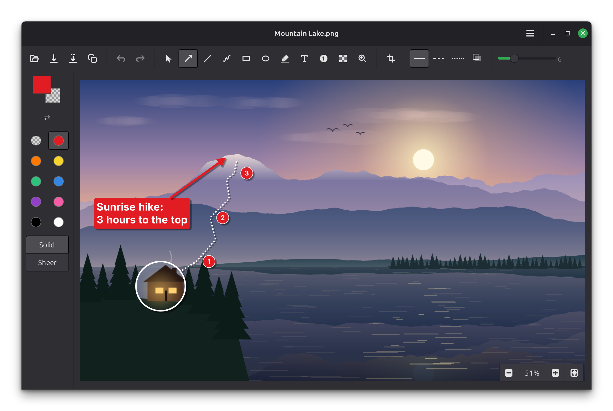
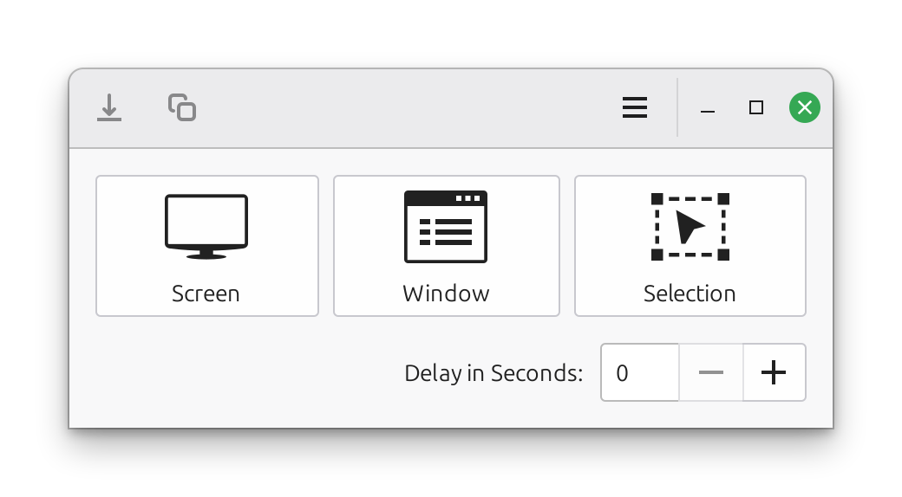
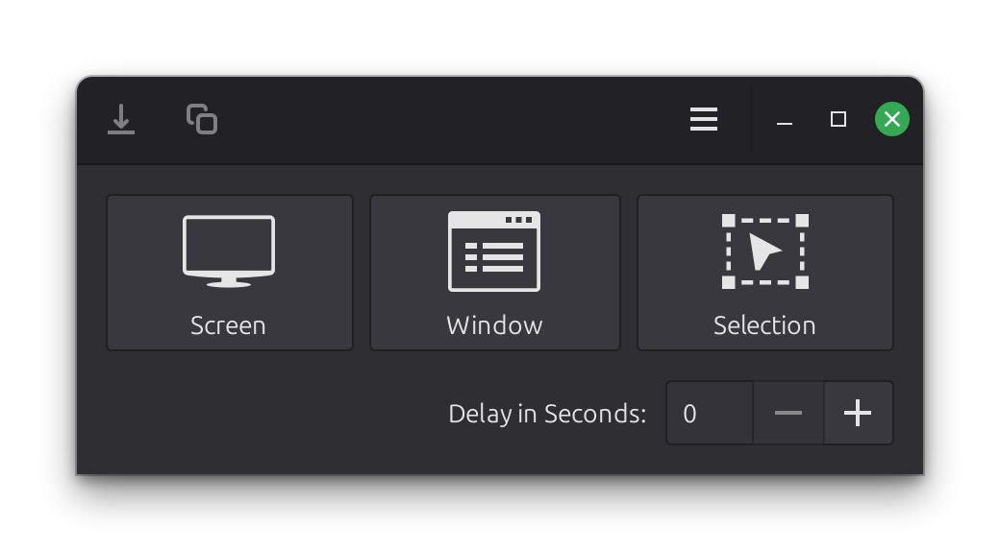
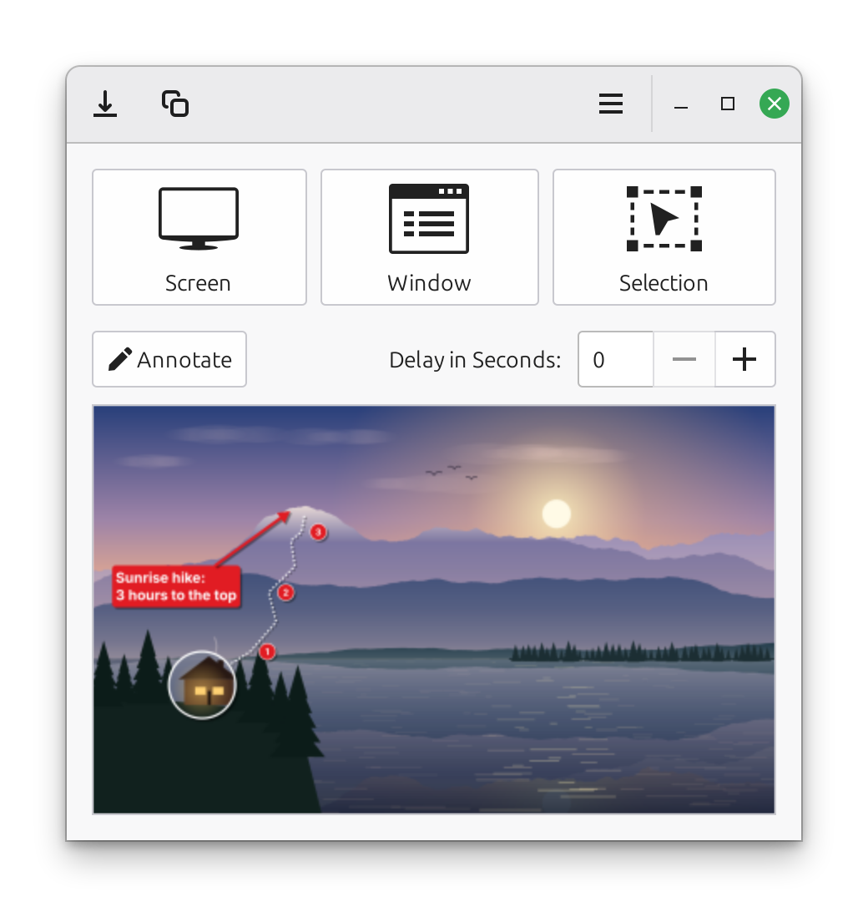
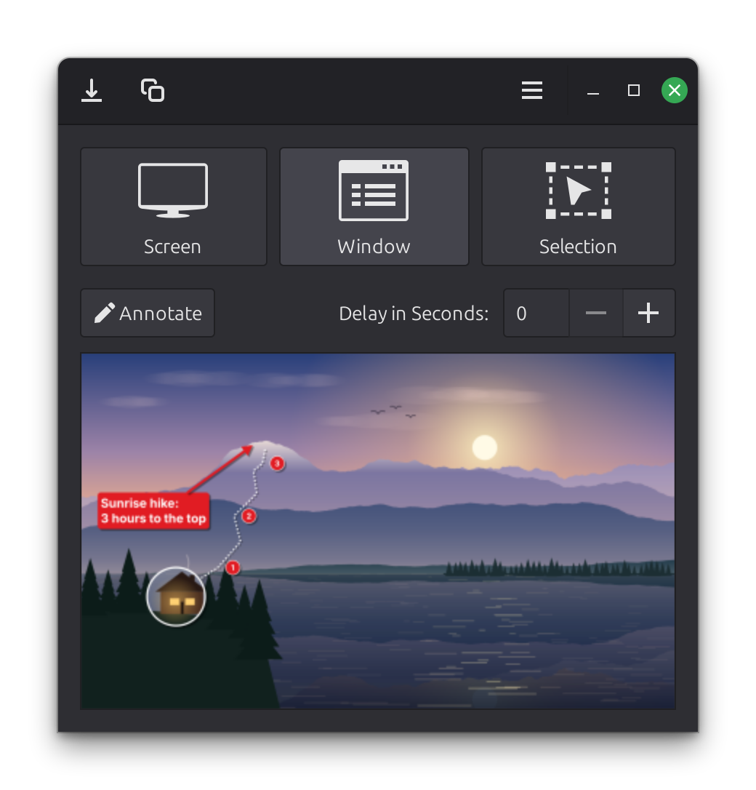
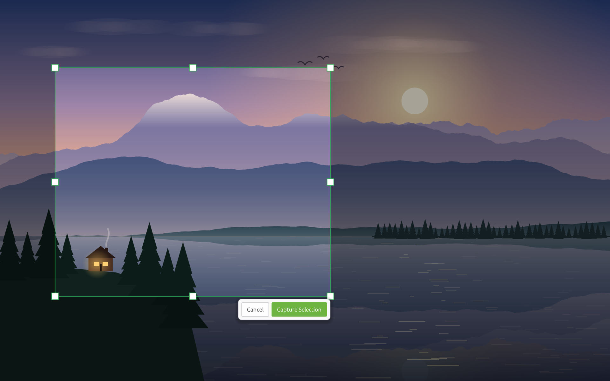
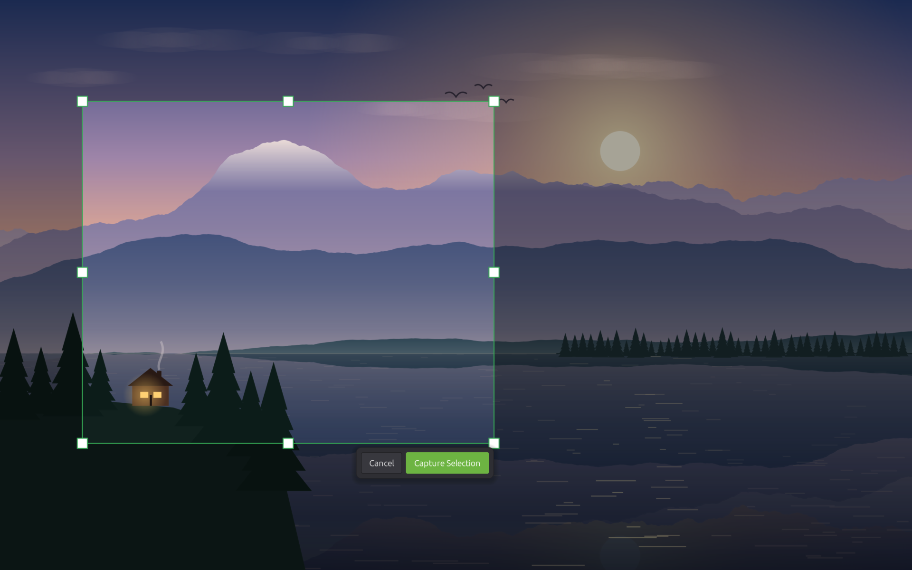
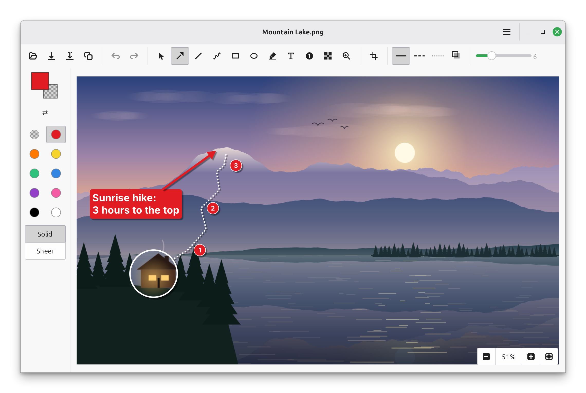

# xl-Screenshot and xl-Annotate

[](https://github.com/xlcheese/xl-screenshot/actions/workflows/tests.yml)

<p align="center">
  
</p>

Two small apps for Linux Mint and the Cinnamon desktop, installed together:

- **xl-Screenshot**: Screen, Window, and Selection captures.
- **xl-Annotate**: simple, light markup for images and screenshots: arrows,
  lines, freehand drawing, rectangles, ellipses, highlighter, text, numbered
  steps, pixelate, a magnifying loupe and crop. Rough freehand lines, arrows,
  circles and boxes are tidied into clean shapes (Keep My Drawing undoes that;
  the menu turns it off). Each mark has a line and a fill colour (solid,
  see-through or none), a size, a line style and an optional shadow, and stays
  editable (move, reshape, restyle, delete) until you save. It runs on its own,
  or from xl-Screenshot's Annotate button.

**[Download the latest .deb](https://github.com/xlcheese/xl-screenshot/releases/latest)**

## Screenshots

Shown in Linux Mint's Mint-Y and Mint-Y-Dark themes; both apps follow
whichever theme you use.

<table>
  <tr><th>Mint-Y</th><th>Mint-Y-Dark</th></tr>
  <tr><td colspan="2" align="center"><b>xl-Screenshot</b>: choose Screen, Window or Selection, with an optional delay</td></tr>
  <tr>
    <td align="center"></td>
    <td align="center"></td>
  </tr>
  <tr><td colspan="2" align="center"><b>After a capture</b>: save it, copy it, or annotate it (or double-click the thumbnail)</td></tr>
  <tr>
    <td align="center"></td>
    <td align="center"></td>
  </tr>
  <tr><td colspan="2" align="center"><b>Selection</b>: drag over the desktop, adjust with the handles, then Capture Selection</td></tr>
  <tr>
    <td align="center"></td>
    <td align="center"></td>
  </tr>
  <tr><td colspan="2" align="center"><b>xl-Annotate</b>: arrows, steps, notes, a loupe and more, all editable until you save</td></tr>
  <tr>
    <td align="center"></td>
    <td align="center"></td>
  </tr>
</table>

## Trying the menu entries and Nemo's "Annotate Image…"

```bash
sudo apt install gettext make
./install-local.sh
```

Adds xl-Screenshot (Accessories) and xl-Annotate (Graphics) to the menu,
puts xl-Annotate in Nemo's Open With, and adds "Annotate Image…" to Nemo's
right-click menu for images. Everything goes in your home folder
(`~/.local/share`) and points at this folder; no sudo. Close Nemo (`nemo -q`)
so it picks up the new item. `./install-local.sh --uninstall` removes it all.

## Installing

```bash
sudo apt install ./xl-screenshot_0.1.1_all.deb
```

This installs both apps (menu: Accessories and Graphics), their icons, the man
pages, and Nemo's "Annotate Image…", along with what they need (GTK,
xdotool, x11-utils, python3-xlib and Mint's tray support). Remove it with
`sudo apt remove xl-screenshot`.

If you used `install-local.sh` before, run `./install-local.sh --uninstall`
first, so the menu doesn't show each app twice.

## Building the .deb

```bash
sudo apt install debhelper dh-python gettext
make deb
```

The package is written to the folder above this one. The version comes from
`debian/changelog` (keep it in step with `APP_VERSION` in both `config.py`
files and the `<release>` in the metainfo files).

## Running from this folder

```bash
make                    # once, to build the translations
./usr/bin/xl-screenshot
```

Options:

- `--selection` (`-s`): start a Selection capture right away. If xl-Screenshot
  is already running, the running copy starts the capture instead.
- `--tray` (`-t`): start with just the tray icon (what the login entry uses).
- `--version` (`-v`): show the version and quit.

**System tray (optional):** turn on *Show in System Tray* in xl-Screenshot's
menu. Clicking the tray icon starts a Selection capture; right-clicking it
offers Show, Screen, Window, Selection and Quit. While it's on, closing the
window only hides it, and xl-Screenshot starts at login
(`~/.config/autostart/io.github.xlcheese.XlScreenshot.desktop`). Turning it
off removes the icon and the login entry. Needs `gir1.2-xapp-1.0` (part of Mint).

Only one copy runs at a time; starting it again brings up the window that is
already open.

```bash
./usr/bin/xl-annotate [IMAGE...]
```

Opens each image in its own window (or an empty window with no image).
Shortcuts: Ctrl+O open, Ctrl+S save, Shift+Ctrl+S save as, Ctrl+V paste an
image, Ctrl+C copy, Ctrl+Z / Shift+Ctrl+Z undo / redo, Delete removes the
selected mark, Esc lets go of it. In Crop: Enter crops, Esc cancels.
Hold Shift while drawing for 45° lines and squares/circles, or while moving
to go straight across or down. Zoom: Ctrl++ / Ctrl+− / Ctrl+scroll, Ctrl+0
fits the window, Ctrl+1 shows actual size. Text: Enter finishes, Shift+Enter
starts a new line.

## Needs

`python3-gi`, `python3-gi-cairo`, `gir1.2-gtk-3.0`, `xdotool` and `x11-utils`
(for Window captures), and `python3-xlib` (for Esc to cancel). `webp-pixbuf-loader`
is optional, for saving WebP.

## Layout

The folders mirror where the files go once installed:

| Path | What |
|---|---|
| `usr/bin/xl-screenshot`, `usr/bin/xl-annotate` | the commands |
| `usr/lib/xl-screenshot/xlscreenshot/` | xl-Screenshot |
| `usr/lib/xl-screenshot/xlannotate/` | xl-Annotate |
| `usr/lib/xl-screenshot/xlshared/` | dialogs and helpers both apps use |
| `usr/share/icons/hicolor/*/apps/` | the two app icons (scalable, plus hand-drawn 32, 24 and 16 px) |
| `usr/share/icons/hicolor/scalable/actions/` | button and tool icons |
| `data/` | templates for the menu entries and Nemo's "Annotate Image…" (`make` writes them into `usr/share/`, translated) |
| `po/` | translations (one `.po` file per language) |
| `install-local.sh` | try the menu entries and Nemo item before there's a .deb |
| `tests/` | the automatic tests (`make check`) |
| `docs/screenshots/` | the pictures on this page |

Inside `xlscreenshot/`:

| Module | What |
|---|---|
| `application.py` | start-up, single copy, command-line options |
| `window.py` | the main window: buttons, delay, thumbnail, save and copy |
| `selection.py` | the full-screen overlay for drawing a selection |
| `capture.py` | grabbing the screen, a region or a window |
| `escape_grab.py` | Esc to cancel while our windows are hidden |
| `tray.py` | the optional tray icon and starting at login |
| `config.py` | name, version, settings file |

Inside `xlannotate/`: `window.py` (header bar, tool bar, open/save),
`canvas.py` (showing the image, the tools, undo), `shapes.py` (the marks),
`tidy.py` (recognising rough freehand shapes), `application.py` and `config.py`.

Settings are kept in `~/.config/xl-screenshot/config.json` and
`~/.config/xl-annotate/config.json`. Settings from
before the rename (`~/.config/xlscreenshot/`) are copied over on first start.

## Tests

About 425 automatic checks cover both apps. They run on every change on
GitHub, and you can run them yourself with `make check`: see
[tests/README.md](tests/README.md).

## Translations

xl-Screenshot and xl-Annotate follow your desktop's language. They come with
German, Spanish, French and Brazilian Portuguese. **These are drafts** written
with the help of an AI and still need checking by native speakers:
corrections are very welcome.

`make` compiles `po/*.po` into `usr/share/locale/`, and writes the menu
entries and the Nemo item with their translations. To try a language without
changing your desktop:

```bash
LANGUAGE=de ./usr/bin/xl-annotate
```

(Quit any copy that's already running first, since a second start just
brings up the open window.)

**Adding a language** (for example Italian, `it`):

1. `msginit --locale=it --input=po/xl-screenshot.pot --output-file=po/it.po`
2. Translate the strings in `po/it.po` (Poedit or any text editor). Keep
   `{name}`-style placeholders as they are, and one `_` in button labels
   (it marks the Alt+ letter).
3. Add `it` to `po/LINGUAS`, then run `make`.

**After changing any text in the code** run `make pot`. It updates
`po/xl-screenshot.pot` and merges the new strings into every `.po` file,
ready for translating.

## Credits

The pointer in the xl-Screenshot app icon is the outline of Linux Mint's
default cursor, Bibata Modern Classic by Abdulkaiz Khatri (GPL-3.0).
