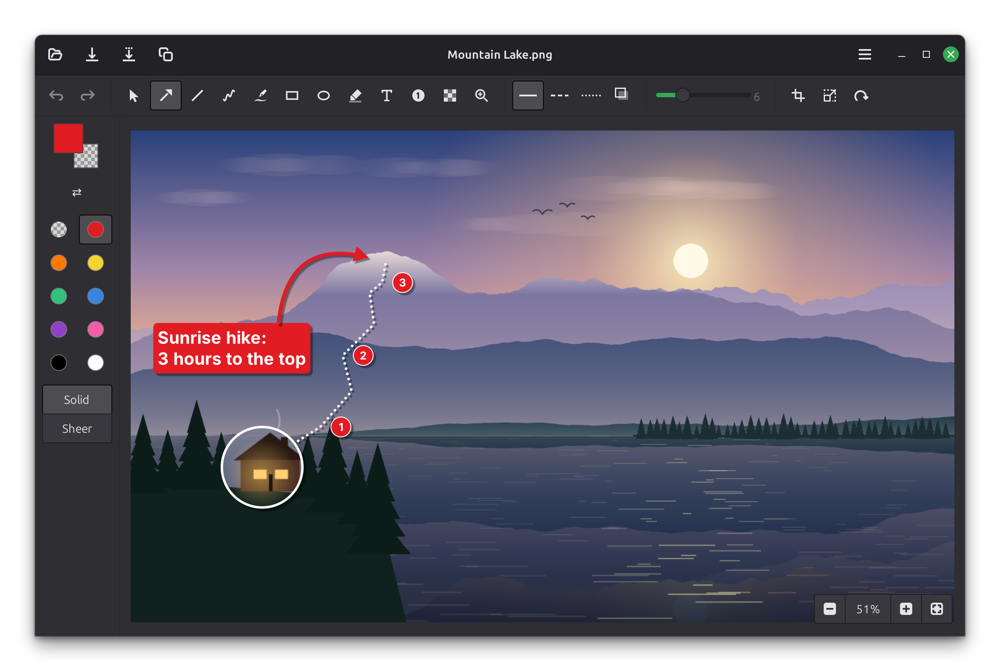
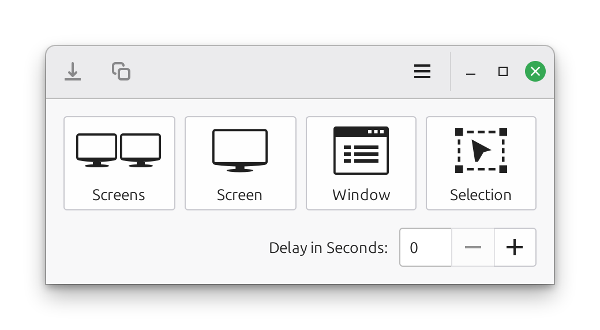
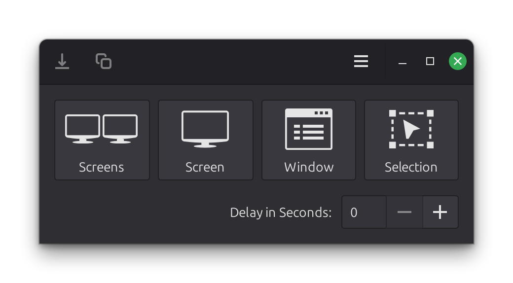
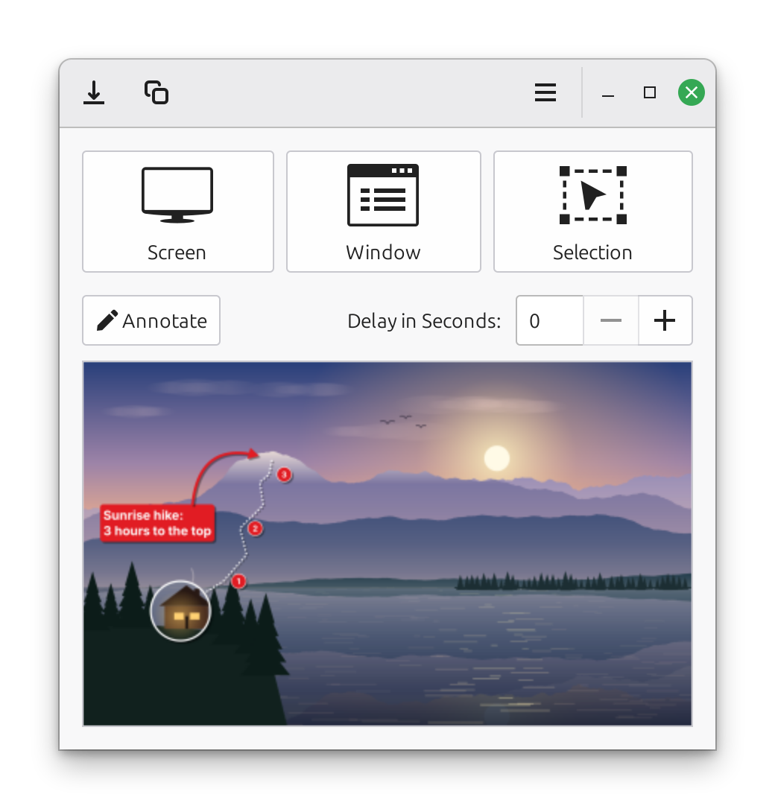
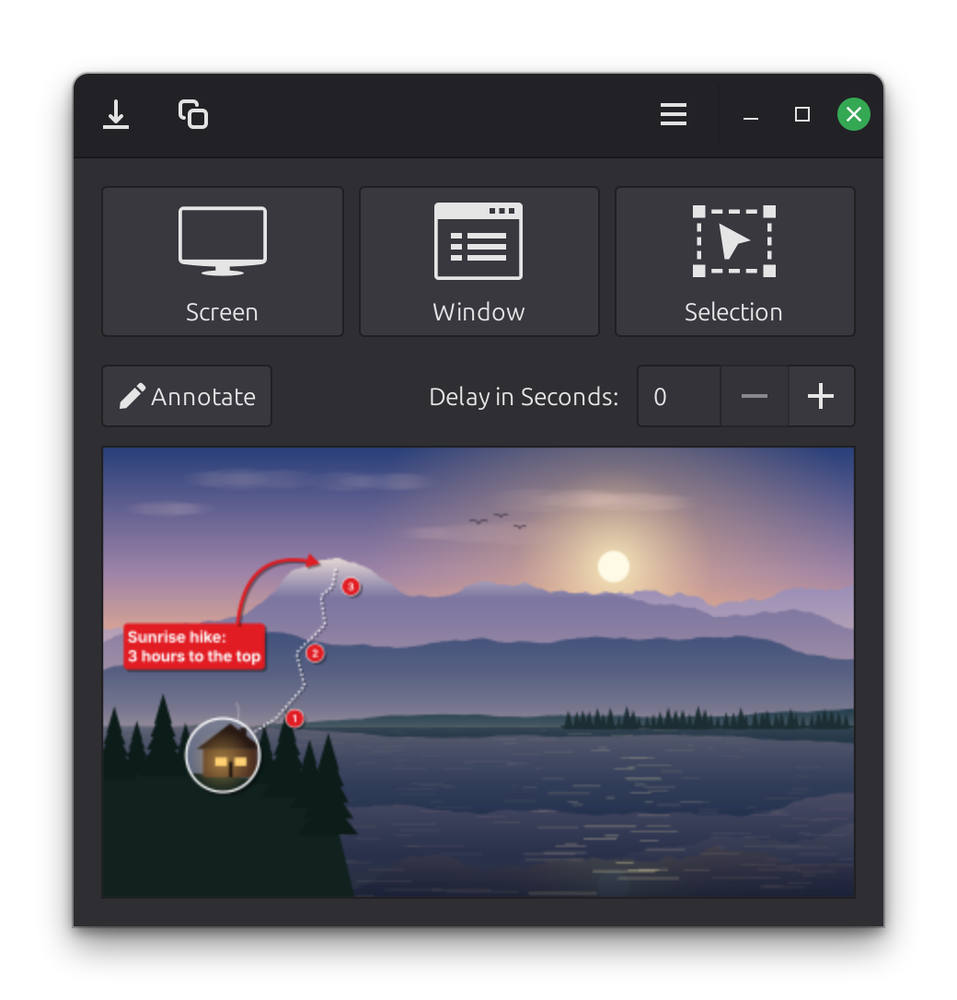
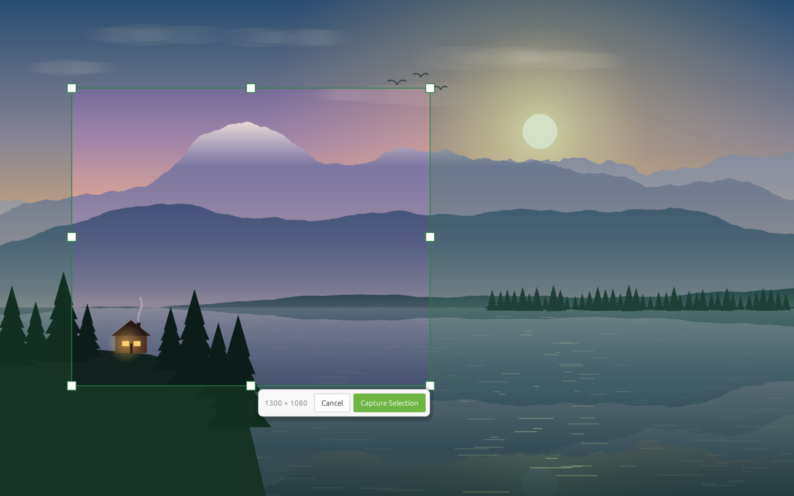
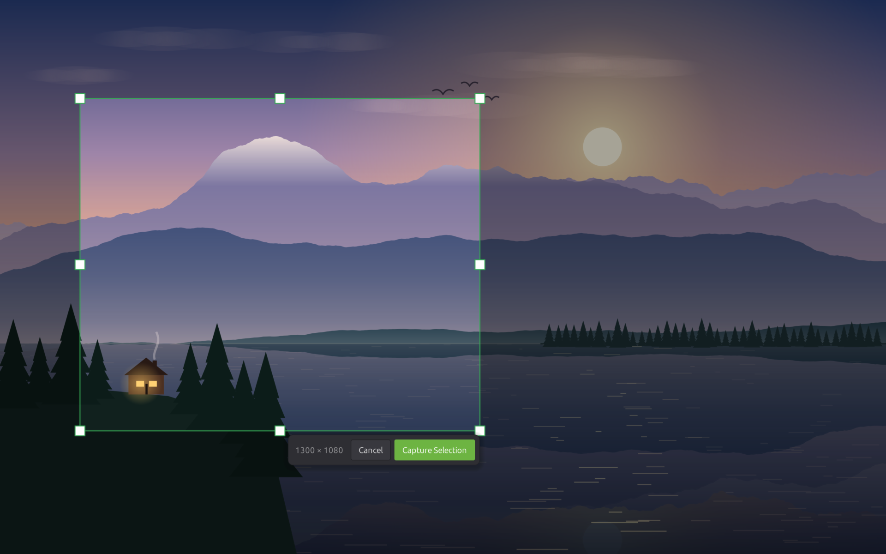
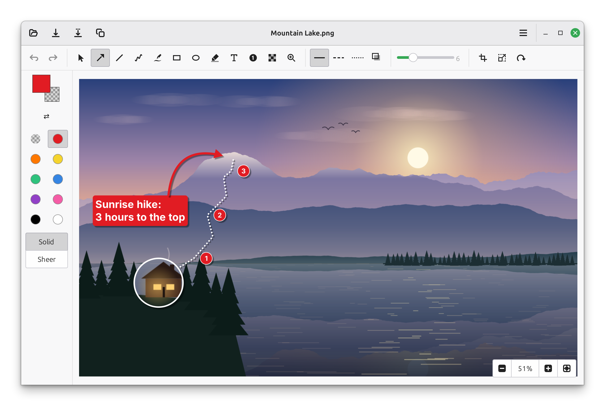

# xl-Screenshot and xl-Annotate

[](https://github.com/xlcheese/xl-screenshot/actions/workflows/tests.yml)

<p align="center">
  
</p>

Two small apps for Linux Mint and the Cinnamon desktop, installed together:

- **xl-Screenshot**: Screen, Window, and Selection captures (and Screens, for
  every monitor, when you have more than one), with an optional delay (up to
  11 seconds) and tray icon. Window capture picks windows like Cinnamon does,
  with clean rounded corners and an optional shadow. Fast Selection captures as
  soon as you let go. Works on X11 and, with Cinnamon, on Wayland.
- **xl-Annotate**: simple, light markup for images and screenshots: arrows and
  lines (straight, or curved with their middle handle), freehand drawing, a
  speed-sensitive ink pen, rectangles, ellipses, highlighter, text, numbered
  steps, pixelate and a magnifying loupe; plus crop (to exact sizes if you
  like), resize, and rotate and flip. Rough freehand lines, arrows, circles and
  boxes are tidied into clean shapes (Keep My Drawing undoes that; the menu
  turns it off). Each mark has a line and a fill color (solid, see-through or
  none), a size, a line style and an optional shadow, and stays editable
  (move, reshape, restyle, delete) until you save; it follows the image when
  it's cropped, resized, rotated or flipped. It runs on its own, or from
  xl-Screenshot's Annotate button.

**[Download the latest .deb](https://github.com/xlcheese/xl-screenshot/releases/latest)**

## Screenshots

Shown in Linux Mint's Mint-Y and Mint-Y-Dark themes; both apps follow
whichever theme you use.

<table>
  <tr><th>Mint-Y</th><th>Mint-Y-Dark</th></tr>
  <tr><td colspan="2" align="center"><b>xl-Screenshot</b>: choose Screen, Window or Selection (and Screens, with more than one monitor), with an optional delay</td></tr>
  <tr>
    <td align="center"></td>
    <td align="center"></td>
  </tr>
  <tr><td colspan="2" align="center"><b>After a capture</b>: save it, copy it, or annotate it (or double-click the thumbnail)</td></tr>
  <tr>
    <td align="center"></td>
    <td align="center"></td>
  </tr>
  <tr><td colspan="2" align="center"><b>Selection</b>: drag over the desktop, adjust with the handles, then Capture Selection</td></tr>
  <tr>
    <td align="center"></td>
    <td align="center"></td>
  </tr>
  <tr><td colspan="2" align="center"><b>xl-Annotate</b>: arrows, steps, notes, a loupe and more, all editable until you save</td></tr>
  <tr>
    <td align="center"></td>
    <td align="center"></td>
  </tr>
</table>

## Trying the menu entries and Nemo's "Annotate Image…"

```bash
sudo apt install gettext make
./install-local.sh
```

Adds xl-Screenshot (Accessories) and xl-Annotate (Graphics) to the menu,
puts xl-Annotate in Nemo's Open With, and adds "Annotate Image…" to Nemo's
right-click menu for images. Everything goes in your home folder
(`~/.local/share`) and points at this folder; no sudo. Close Nemo (`nemo -q`)
so it picks up the new item. `./install-local.sh --uninstall` removes it all.

## Works on

It's made for Linux Mint's Cinnamon desktop, and looks at home on other GTK
desktops too. Newer versions of Cinnamon have a screenshot service of their
own; xl-Screenshot uses it when it's there, which is also what makes it work
on Cinnamon's **Wayland** session. Without it, it captures through **X11**.

**Tested**

- **Linux Mint 22 Cinnamon** (X11): everyday use, with one and two monitors.
- **Linux Mint 27 beta** (Cinnamon): its X11 and Wayland sessions.
- **Ubuntu 24.04** (the base of Mint 22): the .deb installs, and the
  [automatic tests](tests/README.md) run on it after every change, including
  both apps running as real Wayland apps.

**Should work: not tried yet, reports welcome**

| Desktop | For example | Notes |
|---|---|---|
| Cinnamon | Linux Mint 21, LMDE, Fedora Cinnamon, Debian | Everything, including Nemo's "Annotate Image…" |
| Xfce | Linux Mint Xfce, Xubuntu, MX Linux, Debian, Fedora Xfce | No right-click item (Thunar is the file manager) |
| MATE | Linux Mint MATE, Ubuntu MATE, Debian, Fedora MATE | No right-click item (Caja is the file manager) |
| Budgie | Ubuntu Budgie | No right-click item |

The tray icon uses Mint's XApp library (`gir1.2-xapp-1.0`), which Debian and
Ubuntu also package. On Debian and Ubuntu based systems the .deb should
install as it is.

**Doesn't work yet: Wayland without Cinnamon**

On other Wayland desktops, the default for GNOME (Ubuntu, Fedora Workstation),
KDE Plasma 6 and COSMIC, xl-Screenshot can't capture yet: it says so rather
than trying. xl-Annotate works there on its own. Support through the
desktops' screenshot portal is on the
[roadmap](https://github.com/xlcheese/xl-screenshot/issues/10).

Tried it somewhere else? Please say how it went in an
[issue](https://github.com/xlcheese/xl-screenshot/issues), working or not, so
this list can grow.

## Installing

```bash
sudo apt install ./xl-screenshot_0.3.0_all.deb
```

This installs both apps (menu: Accessories and Graphics), their icons, the man
pages, and Nemo's "Annotate Image…", along with what they need (GTK,
x11-utils, python3-xlib and Mint's tray support). Remove it with
`sudo apt remove xl-screenshot`.

If you used `install-local.sh` before, run `./install-local.sh --uninstall`
first, so the menu doesn't show each app twice.

## Building the .deb

```bash
sudo apt install debhelper dh-python gettext
make deb
```

The package is written to the folder above this one. The version comes from
`debian/changelog` (keep it in step with `APP_VERSION` in both `config.py`
files and the `<release>` in the metainfo files).

## Running from this folder

```bash
make                    # once, to build the translations
./usr/bin/xl-screenshot
```

Options:

- `--selection` (`-s`): start a Selection capture right away. If xl-Screenshot
  is already running, the running copy starts the capture instead.
- `--tray` (`-t`): start with just the tray icon (what the login entry uses).
- `--version` (`-v`): show the version and quit.
- `--help` (`-h`): every option, including the command-line captures below.

**Command-line captures (for scripts and keyboard shortcuts):** with any of
these options, xl-Screenshot captures, saves and exits, with no window. Many
follow scrot's, and scrot's spellings work too. Positions and sizes are in real
pixels. It works on X11 and, through Cinnamon's screenshot service, on Wayland.

```bash
xl-screenshot --area 100,100,400,300 --file ~/area.png    # a rectangle
xl-screenshot --screens                                    # every screen, into Pictures/xl-Screenshot
xl-screenshot --screen 2 -d 3 'Screen-2_%H%M%S.jpg'        # screen 2, after 3 seconds
xl-screenshot --selection --clipboard                      # draw an area, copy it
xl-screenshot --focused --shadow                           # the focused window
xl-screenshot -a 0,0,800,600 - | magick - -resize 50% small.png
```

| What to capture | |
|---|---|
| `--screens` (`-m`) | every screen (the default) |
| `--screen [N]` (`-M`) | screen N (see `--list-screens`), or the one the pointer is on (X11) |
| `--area X,Y,W,H` (`-a`) | a rectangle |
| `--selection` (`-s`) | draw the area, as with the Selection button |
| `--window` | pick a window, as with the Window button |
| `--focused` (`-u`) | the window that has the focus |
| `--window-id WID` (`-w`) | a window by its X11 id (X11 only) |

| Options | |
|---|---|
| `--file FILE` (`-F`), or just `FILE` | where to save; `-` is standard output. `%Y-%m-%d`… (strftime), `$w`, `$h` |
| `--overwrite` (`-o`) | replace an existing file (otherwise `_1`, `_2`… is added) |
| `--format FMT`, `--quality N` (`-q`) | png, jpeg or webp; JPEG/WebP quality (90) |
| `--clipboard` | copy the image (saved too only if a file is given) |
| `--annotate` | open it in xl-Annotate |
| `--delay SEC` (`-d`), `--pointer` (`-p`), `--shadow` | as in the app |
| `--list-screens` | the screens' numbers, sizes and positions |

The saved file's path is printed. Exit status: 0 saved, 1 nothing captured
(canceled or failed), 2 a mistake in the options.

**System tray (optional):** turn on *Show in System Tray* in xl-Screenshot's
menu. Clicking the tray icon starts a Selection capture; right-clicking it
offers Show, Screen, Window, Selection and Quit. While it's on, closing the
window only hides it, and xl-Screenshot starts at login
(`~/.config/autostart/io.github.xlcheese.XlScreenshot.desktop`). Turning it
off removes the icon and the login entry. Needs `gir1.2-xapp-1.0` (part of Mint).

Only one copy runs at a time; starting it again brings up the window that is
already open.

```bash
./usr/bin/xl-annotate [IMAGE...]
```

Opens each image in its own window (or an empty window with no image).
Shortcuts: Ctrl+O open, Ctrl+S save, Shift+Ctrl+S save as, Ctrl+V paste an
image, Ctrl+C copy, Ctrl+Z / Shift+Ctrl+Z undo / redo, Delete removes the
selected mark, Esc lets go of it. In Crop: Enter crops, Esc cancels; the
popover by the Crop button takes exact positions and sizes. R / Shift+R rotate
right / left, L / Shift+L flip horizontally / vertically.
Hold Shift while drawing for 45° lines and squares/circles, or while moving
to go straight across or down. Zoom: Ctrl++ / Ctrl+− / Ctrl+scroll, Ctrl+0
fits the window, Ctrl+1 shows actual size. Text: Enter finishes, Shift+Enter
starts a new line.

## Needs

`python3-gi`, `python3-gi-cairo`, `gir1.2-gtk-3.0`, `librsvg2-common`,
`gir1.2-xapp-1.0` (the tray icon), and, for capturing on X11, `x11-utils` and
`python3-xlib`. `webp-pixbuf-loader` is optional, for saving WebP. Newer Cinnamon
versions also have a screenshot service of their own, which xl-Screenshot uses
when it's there, on X11 and Wayland alike.

## Layout

The folders mirror where the files go once installed:

| Path | What |
|---|---|
| `usr/bin/xl-screenshot`, `usr/bin/xl-annotate` | the commands |
| `usr/lib/xl-screenshot/xlscreenshot/` | xl-Screenshot |
| `usr/lib/xl-screenshot/xlannotate/` | xl-Annotate |
| `usr/lib/xl-screenshot/xlshared/` | dialogs and helpers both apps use |
| `usr/share/icons/hicolor/*/apps/` | the two app icons (scalable, plus hand-drawn 32, 24 and 16 px) |
| `usr/share/icons/hicolor/scalable/actions/` | button and tool icons |
| `data/` | templates for the menu entries and Nemo's "Annotate Image…" (`make` writes them into `usr/share/`, translated) |
| `po/` | translations (one `.po` file per language) |
| `install-local.sh` | try the menu entries and Nemo item before there's a .deb |
| `tests/` | the automatic tests (`make check`) |
| `docs/screenshots/` | the pictures on this page (`make/make-screenshots` re-makes them) |

Inside `xlscreenshot/`:

| Module | What |
|---|---|
| `application.py` | start-up, single copy, command-line options |
| `window.py` | the main window: buttons, delay, thumbnail, save and copy |
| `selection.py` | the full-screen overlay for drawing a selection, and the window picker |
| `capture.py` | grabbing the screen, a region or a window (X11) |
| `cinnamon_service.py` | capturing through Cinnamon's own screenshot service (X11 and Wayland) |
| `cli.py` | command-line captures (`--area`, `--screens`, `--file`…), for scripts |
| `x11_windows.py` | where the windows are, for the window picker (X11) |
| `window_look.py` | rounded corners and a drawn shadow for X11 window captures |
| `screens_icon.py` | the Screens button's icon, drawn from your monitors' layout |
| `escape_grab.py` | Esc to cancel while our windows are hidden |
| `tray.py` | the optional tray icon and starting at login |
| `config.py` | name, version, settings file |

Inside `xlannotate/`: `window.py` (header bar, tool bar, open/save),
`canvas.py` (showing the image, the tools, undo), `shapes.py` (the marks),
`tidy.py` (recognising rough freehand shapes), `application.py` and `config.py`.

Settings are kept in `~/.config/xl-screenshot/config.json` and
`~/.config/xl-annotate/config.json`. Settings from
before the rename (`~/.config/xlscreenshot/`) are copied over on first start.

## Tests

About 425 automatic checks cover both apps. They run on every change on
GitHub, and you can run them yourself with `make check`: see
[tests/README.md](tests/README.md).

## Translations

xl-Screenshot and xl-Annotate follow your desktop's language. They come with
German, Spanish, French, Brazilian Portuguese and Russian. **These are drafts**
written with the help of an AI and still need checking by native speakers:
corrections are very welcome.

**Your language missing, or a translation that reads oddly?** Please
[open an issue](https://github.com/xlcheese/xl-screenshot/issues) or send a
pull request. You don't need to know any programming: a translation is one
text file of short phrases (see *Adding a language* below), and a native
speaker's corrections are what turn a draft into a good translation.

`make` compiles `po/*.po` into `usr/share/locale/`, and writes the menu
entries and the Nemo item with their translations. To try a language without
changing your desktop:

```bash
LANGUAGE=de ./usr/bin/xl-annotate
```

(Quit any copy that's already running first, since a second start just
brings up the open window.)

**Adding a language** (for example Italian, `it`):

1. `msginit --locale=it --input=po/xl-screenshot.pot --output-file=po/it.po`
2. Translate the strings in `po/it.po` (Poedit or any text editor). Keep
   `{name}`-style placeholders as they are, and one `_` in button labels
   (it marks the Alt+ letter).
3. Add `it` to `po/LINGUAS`, then run `make`.

**After changing any text in the code** run `make pot`. It updates
`po/xl-screenshot.pot` and merges the new strings into every `.po` file,
ready for translating.

## Credits

The pointer in the xl-Screenshot app icon is the outline of Linux Mint's
default cursor, Bibata Modern Classic by Abdulkaiz Khatri (GPL-3.0).
